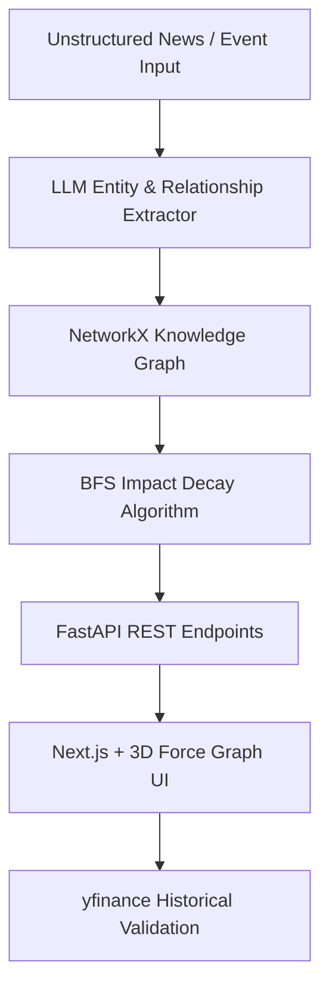

# 🚀 MVP Implementation & Outstanding UI Master Plan
**Project:** Autonomous Financial Event Market Impact Graph  
**Hackathon:** Hackwave 3.0  
**Based on:** `codenovicesHack` Repository Architecture  

---

## 📐 1. UI/UX Design Strategy (The "WOW" Factor)

To win the hackathon, the UI must look like a **next-generation Fintech Intelligence Command Deck**.

### Visual Aesthetic & Theme
*   **Theme:** Dark Obsidian Glassmorphism (`#070a12` deep background).
*   **Typography:** `Outfit` (for headlines) + `JetBrains Mono` (for financial metrics & telemetry).
*   **3D Graph Visualization:** `react-force-graph-3d` (Three.js powered) with:
    *   Glowing 3D spheres for nodes.
    *   Directional particle streams along edges showing energy/impact flow.
    *   Dynamic node coloring (Red = Trigger Event, Gold = Macro Variable, Cyan = Sector, Green = Stock Asset).

---

## 🛠️ 2. Architectural Phases

### Phase 1: Outstanding Frontend UI (Client Layer)
- [x] **Top Bar:** Live Market Ticker (Crude Oil, Nifty, USD/INR) + Pulsing Live Status.
- [x] **Left Control Dock:**
  - Pre-built demo scenarios (Crude Oil Shock, RBI Rate Hike, Semi Export Ban).
  - "What-If" text input prompt for custom news headlines.
  - Interactive Legend.
- [x] **Center Viewport:** Fullscreen 3D Force Graph canvas with rotate, zoom, and node-click listeners.
- [x] **Right Inspector Dock:**
  - Node/Edge details & Impact Score (% rise/fall prediction).
  - LLM Explanation Box explaining *why* the connection exists.
  - Stock Price Sparkline validation chart.

### Phase 2: Python FastAPI Backend (Intelligence Layer)
- [ ] `main.py`: FastAPI server with CORS enabled.
- [ ] `llm/extractor.py`: LLM pipeline (Gemini / Claude via OpenRouter) to extract structured JSON (Entities & Edges) from news text.
- [ ] `graph/builder.py`: NetworkX graph construction engine.
- [ ] `graph/propagation.py`: BFS Decay algorithm calculating downstream impact scores.
- [ ] `data/market.py`: `yfinance` integration for fetching real historical stock data.

---

## 📋 3. Step-by-Step Execution Plan

| Step | Module | Task Description | Status |
| :--- | :--- | :--- | :---: |
| **Step 1** | **UI Prototype** | Create standalone 3D Graph UI with Three.js & Glassmorphism | ✅ Completed |
| **Step 2** | **Backend Setup** | Initialize FastAPI backend structure with NetworkX graph | ⏳ Next |
| **Step 3** | **LLM Extractor** | Connect Gemini/OpenRouter to parse news into JSON schema | ⏳ Pending |
| **Step 4** | **Propagation Engine** | Implement BFS algorithm for multi-hop ripple scoring | ⏳ Pending |
| **Step 5** | **yfinance Sync** | Wire stock ticker sparklines to live market API | ⏳ Pending |

---

## 🎯 4. Demo Pitch Checklist

- [ ] User opens 3D Graph UI and is immediately impressed by the 3D visual canvas.
- [ ] User clicks "Crude Oil (+12%)" → Particles stream through the graph in 3D.
- [ ] Clicking on "Real Estate Sector" opens the Inspector sidebar with LLM explanations.
- [ ] User types custom "What-If" headline → AI updates the graph dynamically.
