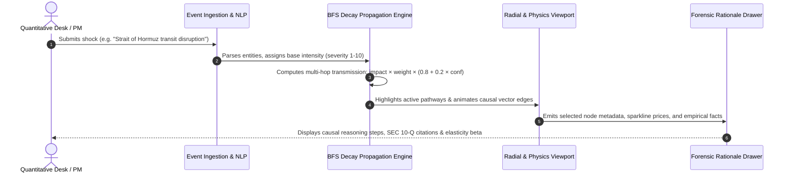

# <p align="center">FinancialGraph</p>
<h3 align="center">Autonomous Market Impact & Systemic Contagion Engine</h3>

<p align="center">
  <em>High-throughput causal network visualizer, multi-hop transmission simulator, and econometric stress-testing engine for systemic risk modeling.</em>
</p>

<p align="center">
  
  
  
  
  
  
  
  
</p>

---

## 📌 Executive Summary & Problem Statement

Modern macroeconomic disruptions—from OPEC+ crude production quotas and maritime chokepoint closures to semiconductor foundry export curbs—do not affect markets in isolation. Traditional terminal architectures and tabular risk reports suffer from critical deficiencies:
- **Delayed Discovery:** Multi-tiered supply chain dependencies hide indirect exposures until corporate quarterly earnings guidance is slashed.
- **Opacity Across Transmission Latencies:** Upstream commodity price shocks transmit to primary producer costs within 48–72 hours, but pass-through into headline inflation and retail corporate margins occurs on a lagged 45–90 day timeline.
- **Lack of Probabilistic Causal Reasoning:** Quantitative desks need clear empirical citations (e.g. 1973 OPEC Embargo, 2020 Supply Chain Gridlock) combined with real-time elasticity models to formulate actionable portfolio hedges.

**FinancialGraph** bridges this gap. It ingest unstructured financial events, constructs deterministic and probabilistic causal networks across assets, and traces systemic contagion hops in real-time.

---

## 🔄 Causal Architecture & Contagion Flow

The engine maps the end-to-end lifecycle of a systemic catalyst from raw headline extraction to multi-asset portfolio drawdown projections:

```
[ Unstructured Financial News / Geopolitical Press Ingestion ]
                            │
                            ▼ (NER Entity Linking & Sentiment Parsing)
        [ Causal Dependency Graph & Vector Feature Extraction ]
                            │
                            ▼ (Multi-Hop Propagation Engine & BFS Decay)
┌─────────────────────────────────────────────────────────────────────────────┐
│ Hop 1: Upstream Commodity Catalysts ($BRENT, $WTI, Natural Gas, Neon, Rare Earths) │
├─────────────────────────────────────────────────────────────────────────────┤
│ Hop 2: Macro Indicators (Core CPI, US 10Y Yields, USD/INR, Container Freight Index)│
├─────────────────────────────────────────────────────────────────────────────┤
│ Hop 3: Sectoral Compression (Refining Margins, Automotive Supply, Air Freight OPEX) │
├─────────────────────────────────────────────────────────────────────────────┤
│ Hop 4: Listed Downstream Equities ($TSMC, Asian Paints, IndiGo, Tata Motors) │
└─────────────────────────────────────────────────────────────────────────────┘
                            │
                            ▼
    [ Empirical Ground Facts vs. Probabilistic Inferences with Confidence Scoring ]
                            │
      ┌─────────────────────┴──────────────────────┐
      ▼                                            ▼
[ Econometric Calibration ]               [ Deep-Dive Forensic Drawer ]
  • OLS Factor Elasticity                   • Historical Case Study Precedent
  • VAR Impulse Response                    • Verified SEC Disclosures
  • Bayesian Causal Decay                   • Quantitative Risk Score (/10)
```

### Mermaid Sequence Pipeline



---

## ⚡ Key Capabilities & Technical Highlights

### 1. Dual-Canvas Scrubbing Engine (60 FPS Performance)
- **Ambient Frame Sequence:** High-efficiency HTML5 background canvas rendering optimized JPEG sequences (`/frames/dash/`) at 24–60 FPS with `ImageBitmap` memory reuse.
- **Zero-Block Interactivity:** Structured with `pointer-events-none` so graph node dragging, panning, and modal interactions remain 100% fluid.

### 2. Hybrid Claymorphic + Glassmorphic Design System
- **100% Solid Claymorphic Cards:** High-contrast, tactile physical depth utilizing dual drop and inner shadows (`clay-surface`, `clay-inset`, `clay-button-primary`, `clay-badge`). Content cards feature zero acrylic blur bleed for crisp readability.
- **Frosted Glass Navigation:** Top application header uses subtle frosted glass (`nav-glass`) with backdrop blur filters.

### 3. 4-Theme Dynamic Architectural Palette
Switch effortlessly between bespoke institutional design themes via CSS custom variables (`var(--clay-surface)`, `var(--text-primary)`, `var(--accent-primary)`, `var(--clay-border)`):
- **Porcelain Matte:** Clinical, high-contrast light mode tailored for daylight equity trading floors.
- **Neon Pink Clay:** Vibrant modern cyber-aesthetic with ultra-sharp contrast tokens.
- **Royal Blue Clay:** Classic Wall Street & Bloomberg terminal deep navy aesthetic.
- **Obsidian Stealth Clay:** OLED true-black dark mode optimized for multi-monitor nocturnal trading.

### 4. 8-Language Offline Localization (`next-intl`)
Full cross-border accessibility across 8 global financial jurisdictions with instant client-side switching:
- **English (`en`)**
- **Hindi (`hi`)**
- **French (`fr`)**
- **Spanish (`es`)**
- **German (`de`)**
- **Japanese (`ja`)**
- **Mandarin (`zh`)**
- **Arabic (`ar` - RTL Ready)**

### 5. Multi-Mode Graph Viewports & Forensics
- **Radial Macro Transmission Canvas:** Center-outward radial catalyst visualization with P1 Critical priority ordering, expandable 2nd-order hops, and reference citation popovers.
- **Force-Directed Physics Graph:** HTML5 Canvas force simulation with live particle velocity, dynamic node repulsion, link elasticity, and ticker price sparklines.
- **Econometric Regression Calibration:** Interactive parameters for OLS Multi-Factor Elasticity ($\Delta Y = \alpha + \beta \Delta X + \epsilon$), Vector Autoregression (VAR Impulse Response), and Bayesian Causal Networks.
- **Institutional RBAC Gate:** Switch between clearance roles (Quant Analyst, Portfolio Manager, Chief Risk Officer, Macro Strategist) with audit-level permissions.

---

## 🛠️ Tech Stack & Dependencies

| Category | Technology |
|---|---|
| **Core Framework** | [Next.js 15+ (App Router, Turbopack)](https://nextjs.org/) |
| **Language** | [TypeScript 5.3+](https://www.typescriptlang.org/) |
| **Styling & System** | [Tailwind CSS v3.4](https://tailwindcss.com/) with Custom Claymorphic Design Tokens |
| **Animation & Motion** | [GSAP ScrollTrigger](https://greensock.com/), [Framer Motion](https://www.framer.com/motion/) |
| **Graph Visualization** | [@xyflow/react (React Flow)](https://reactflow.dev/) + Custom HTML5 Force Physics Canvas |
| **Internationalization**| [next-intl](https://next-intl-docs.vercel.app/) (8 Active Locales) |
| **Iconography** | [Lucide React](https://lucide.dev/) |

---

## 🚀 Quickstart & Installation

### Prerequisites
- Node.js `v18.18.0` or higher
- npm `v9.0.0` or higher

### 1. Clone & Install Dependencies
```bash
git clone https://github.com/your-org/financial-graph-systemic-risk.git
cd financial-graph-systemic-risk
npm install
```

### 2. Run the Development Server
```bash
npm run dev
```
Open [http://localhost:3000](http://localhost:3000) (or the next available port indicated in your console) to launch the landing page and interactive engine.

### 3. Verify Codebase Integrity
```bash
# Type-check TypeScript codebase
npm run type-check

# Build optimized production bundle
npm run build

# Start production server
npm run start
```

---

## 📂 Project Directory Structure

```plaintext
financial-graph-systemic-risk/
├── messages/                    # 8-Language Localization Dictionaries (en, hi, fr, es, de, ja, zh, ar)
├── public/                      # Static assets, branding, and frame sequences
│   └── frames/dash/             # Pre-rendered 60 FPS motion frame assets (0001-0120)
├── src/
│   ├── app/
│   │   ├── [locale]/            # Localized Next.js App Router dynamic routes
│   │   │   ├── page.tsx         # Landing Page with Hero and Parallax scrubbing
│   │   │   └── dashboard/       # Institutional FinancialGraph Workspace
│   │   │       ├── page.tsx     # Primary dual-canvas dashboard workspace
│   │   │       ├── events/      # News NLP event extractor
│   │   │       ├── paths/       # Affected assets roster & risk matrix
│   │   │       ├── scenarios/   # Scenario stress-testing desk
│   │   │       └── settings/    # API keys & model parameter configurations
│   ├── components/
│   │   ├── dashboard/
│   │   │   ├── DashBackgroundCanvas.tsx    # Optimized background frame canvas
│   │   │   ├── DashboardShell.tsx          # Shell layout with app rail & quick-search
│   │   │   └── teammate/                   # Integrated institutional module views
│   │   │       ├── RadialTransmissionCanvas.tsx # Center-outward radial catalyst canvas
│   │   │       ├── InteractiveGraph.tsx         # Physics force-directed simulation canvas
│   │   │       ├── ScenarioHeader.tsx           # Live KPI cards & catalyst switcher
│   │   │       ├── ImpactPathwaysPanel.tsx      # Rationale, evidence & transmission drawer
│   │   │       ├── EventRegressionModal.tsx     # Econometric OLS/VAR calibration modal
│   │   │       ├── RbacLoginModal.tsx           # Institutional clearance & identity gate
│   │   │       ├── CompanyDrilldownModal.tsx    # Listed equities margin sensitivity breakdown
│   │   │       ├── AddStockModal.tsx            # Custom ticker ingestion modal
│   │   │       ├── SparklineChart.tsx           # Mini price telemetry sparkline
│   │   │       ├── TopNav.tsx                   # Glassmorphic header with themes & locales
│   │   │       ├── Sidebar.tsx                  # Collapsible multi-module application dock
│   │   │       ├── SectorHeatmapView.tsx        # Treemap & contagion matrix view
│   │   │       ├── AIHubInsightsView.tsx        # Autonomous causal intelligence feed
│   │   │       ├── MarketOverviewView.tsx       # Real-time multi-asset index monitoring
│   │   │       ├── AuditReportsView.tsx         # Model risk compliance and verification audit
│   │   │       └── EngineSettingsView.tsx       # BFS decay factors & API configurations
│   ├── data/
│   │   └── fingraph/            # Institutional scenario seeds & supply chain models
│   ├── lib/
│   │   ├── api/fingraphApi.ts   # Unified API client with automatic offline failover
│   │   └── graph/engine.ts      # Deterministic BFS decay propagation calculation engine
│   └── types/
│       └── fingraph/types.ts    # Comprehensive TypeScript interfaces & domain models
└── tailwind.config.js           # Theme color tokens, custom dual-shadow clay utilities
```

---

## ⚖️ License & Intellectual Property

Distributed under the **MIT License**. See `LICENSE` for details. Built for financial engineering hackathons, quantitative research groups, and systemic risk monitoring desks.
