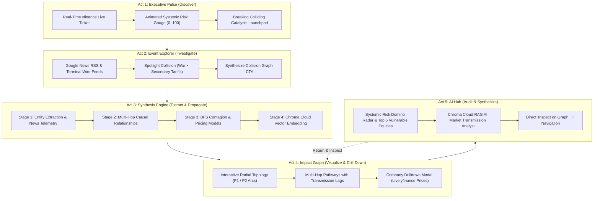
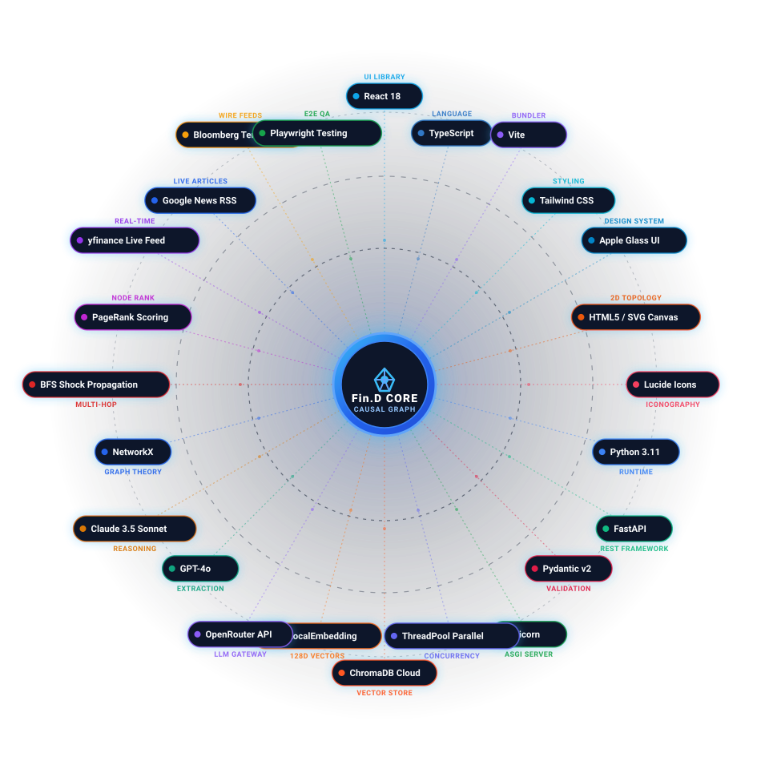
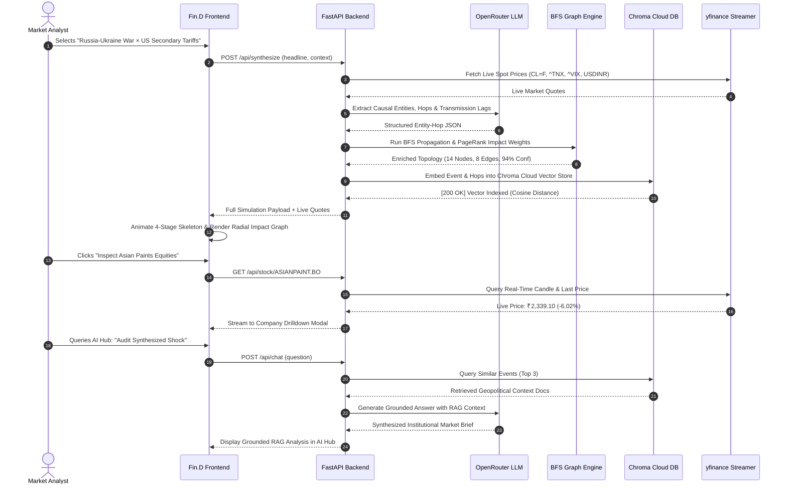

# 🌐 Fin.D (Finance-Dost) — Autonomous Financial Event Market Impact Graph

[](https://fastapi.tiangolo.com/)
[](https://react.dev/)
[](https://www.typescriptlang.org/)
[](https://trychroma.com/)
[](https://pypi.org/project/yfinance/)
[](https://tailwindcss.com/)
[](LICENSE)

> **Autonomous Multi-Hop Financial Shock Modeling & Causal Transmission Engine**  
> Converts unstructured breaking news and geopolitical catalysts into interactive causal dependency graphs, traces contagion across supply chains and assets, and delivers institutional RAG intelligence grounded in live market pricing.

---

## 📑 Table of Contents
1. [Executive Overview & Problem Statement](#-executive-overview--problem-statement)
2. [5-Act Institutional User Story](#-5-act-institutional-user-story)
3. [Technology Stack Constellation](#️-technology-stack-constellation)
4. [System Architecture & Data Flow](#-system-architecture--data-flow)
5. [Causal Shock Transmission Mechanism](#-causal-shock-transmission-mechanism)
6. [Core Platform Capabilities](#-core-platform-capabilities)
7. [API Specification](#-api-specification)
8. [Vector Database & Semantic Memory](#-vector-database--semantic-memory)
9. [Live Market Data & yfinance Streaming](#-live-market-data--yfinance-streaming)
10. [Local Development & Setup Guide](#-local-development--setup-guide)
11. [Repository Structure](#-repository-structure)

---

## 💡 Executive Overview & Problem Statement

Financial events do not occur in isolation. When crude oil surges $14.2\%$ or semiconductor foundry output halts:
- **Upstream input costs** expand immediately across transport, power, and petrochemicals.
- **Midstream margins** compress with asymmetric time lags (e.g. 30–60 days for paint and auto manufacturers).
- **Macro policy indices** reprice (inflation prints, bond yields, forex exchange rates).
- **Final equities** sell off selectively based on raw material sensitivity and pricing power.

Traditional financial terminals present these developments as disconnected headlines. **Fin.D** solves this fragmentation by building a deterministic, explainable, and multi-hop **Causal Impact Graph** grounded in real-time streaming data.

---

## 🧭 5-Act Institutional User Story



---

## 🛠️ Technology Stack Constellation

```mermaid
graph TD
    classDef core fill:#0284c7,stroke:#38bdf8,stroke-width:3px,color:#fff,font-weight:bold;
    classDef fe fill:#0f172a,stroke:#38bdf8,stroke-width:1.5px,color:#e2e8f0;
    classDef be fill:#0f172a,stroke:#10b981,stroke-width:1.5px,color:#e2e8f0;
    classDef ai fill:#0f172a,stroke:#f59e0b,stroke-width:1.5px,color:#e2e8f0;
    classDef graphEngine fill:#0f172a,stroke:#ec4899,stroke-width:1.5px,color:#e2e8f0;
    classDef mkt fill:#0f172a,stroke:#a855f7,stroke-width:1.5px,color:#e2e8f0;
    classDef dev fill:#0f172a,stroke:#64748b,stroke-width:1.5px,color:#e2e8f0;

    CORE(("🌐 Fin.D CORE<br/>Causal Engine")):::core

    %% Frontend Cluster
    CORE --- FE_REACT["React 18"]:::fe
    CORE --- FE_TS["TypeScript 5.0"]:::fe
    CORE --- FE_VITE["Vite"]:::fe
    CORE --- FE_TW["Tailwind CSS"]:::fe
    CORE --- FE_CANVAS["HTML5 / SVG Topology"]:::fe
    CORE --- FE_GLASS["Apple Glass UI"]:::fe

    %% Backend Cluster
    CORE --- BE_PY["Python 3.11"]:::be
    CORE --- BE_FASTAPI["FastAPI"]:::be
    CORE --- BE_PYDANTIC["Pydantic v2"]:::be
    CORE --- BE_UVI["Uvicorn ASGI"]:::be
    CORE --- BE_CONCUR["ThreadPool Concurrency"]:::be

    %% AI & Vector Store Cluster
    CORE --- AI_CHROMA["ChromaDB Cloud Vector Store"]:::ai
    CORE --- AI_OPENROUTER["OpenRouter Gateway"]:::ai
    CORE --- AI_GPT["GPT-4o Extraction"]:::ai
    CORE --- AI_CLAUDE["Claude 3.5 Sonnet Reasoning"]:::ai
    CORE --- AI_EMBED["FastLocalEmbedding (128D)"]:::ai

    %% Graph Engine Cluster
    CORE --- GR_NX["NetworkX Topology"]:::graphEngine
    CORE --- GR_BFS["BFS Shock Propagation"]:::graphEngine
    CORE --- GR_PR["PageRank Centrality"]:::graphEngine

    %% Market Data Ingestion Cluster
    CORE --- MK_YF["yfinance Live Streaming Feed"]:::mkt
    CORE --- MK_GNEWS["Google News RSS Telemetry"]:::mkt
    CORE --- MK_WIRE["Terminal & Wire Feeds"]:::mkt

    %% Tooling & Verification
    CORE --- TL_PLAY["Playwright E2E Testing"]:::dev
    CORE --- TL_GIT["GitHub CI/CD"]:::dev
```

<p align="center">
  
</p>



| Layer | Technologies | Role in Platform |
| :--- | :--- | :--- |
| **User Interface** | React 18, TypeScript, Tailwind CSS, Vite | Responsive institutional terminal, sub-millisecond tab switching, type-safe models |
| **Topology & Graphics** | HTML5 Canvas, SVG Paths, Apple Glass Mesh | 2D radial force layouts, animated gradient risk gauge, interactive satellite nodes |
| **API Backend** | FastAPI, Python 3.11, Pydantic, Uvicorn | Async high-performance endpoints, OpenAPI schemas, resilient error handling |
| **Vector Database** | ChromaDB Cloud (`.env` configured) | Semantic embedding storage and cosine similarity retrieval for RAG chat |
| **Graph Intelligence** | NetworkX, BFS Contagion, PageRank | Topological graph modeling, multi-hop propagation tracing, node centrality |
| **Market Data** | `yfinance`, Google News RSS, ThreadPoolExecutor | Sub-second parallel live quotes across global benchmarks and Indian equities |
| **Verification & QA** | Playwright Browser MCP, Pytest | End-to-end user story simulation, automated regression checks, DOM assertion |

---

## 🏗️ System Architecture & Data Flow

```mermaid
flowchart LR
    subgraph Ingestion["1. Multi-Source Ingestion Layer"]
        RSS["Google News RSS Feed"]
        YF["yfinance Streaming API (60s Cache)"]
        WIRE["Terminal Feeds (Bloomberg, Reuters Wire, OFAC)"]
        USER["Analyst Catalyst Prompt"]
    end

    subgraph Processing["2. Engine & Graph Core (FastAPI)"]
        EXT["LLM Entity Extractor (OpenRouter)"]
        BFS["BFS Shock Propagation & PageRank Scoring"]
        MKT["Parallel ThreadPool Market Resolver (.BO / .NS)"]
    end

    subgraph Storage["3. Knowledge & Vector Store"]
        CHROMA[("ChromaDB Cloud Vector Store\n(Configured via .env)")]
        NX[("NetworkX In-Memory\nCausal Graph Topology")]
    end

    subgraph Presentation["4. Institutional Frontend (React + Vite)"]
        PULSE["Executive Pulse\n(Gauge + Stats)"]
        EXPLORER["Event Explorer\n(Collision Cards)"]
        CANVAS["Radial Canvas\n(Apple Glass Mesh)"]
        MODAL["Equity Breakdown\n(Live yfinance Badge)"]
        AIHUB["AI Hub Insights\n(Chroma RAG Stream)"]
    end

    Ingestion --> Processing
    Processing --> Storage
    Storage --> Presentation
    Processing --> Presentation
```



---

## ⚡ Causal Shock Transmission Mechanism



---

## ✨ Core Platform Capabilities

| Capability | Technical Mechanism | User Value |
| :--- | :--- | :--- |
| **Systemic Stress Gauge** | SVG `stroke-dasharray` / `stroke-dashoffset` gradient arc with glowing tip indicator | Instant visualization of macroeconomic contagion severity ($0$ to $100$) |
| **Causal Collision Explorer** | Multi-headline intersection engine | Uncovers compound risks (e.g. supply bottleneck $\times$ punitive trade tariffs) |
| **Telemetry Skeleton Overlay** | 4-stage animated modal pipeline | Transparent insight into entity extraction, graph propagation, and vector indexing |
| **Radial Impact Canvas** | Apple Glass mesh UI with 2D force topology and P1 Critical / P2 High arcs | Intuitive navigation of multi-tier supply chains and macroeconomic dominoes |
| **Live Equity Drilldown** | Multi-market symbol routing (`.BO` / `.NS` / US ADRs) with official `yfinance` badge | Inspects company-level gross margin sensitivity, market cap, and live price deltas |
| **Hosted Chroma Cloud RAG** | High-performance embedding function querying hosted Chroma Cloud | Context-grounded conversational analyst answering supply chain and equity questions |
| **Crisis Replay Engine** | Historical shock archive (1973 OPEC, 2008 Lehman, 2020 COVID, 2023 SVB) | Compares current market shock dynamics against empirical drawdown precedents |
| **Sector Heatmap Matrix** | Constituent weighted sector grid | Real-time monitoring of Banking, IT, FMCG, Auto, and Energy performance |

---

## 🔌 API Specification

### `GET /api/market/live-quotes`
Fetches real-time price time-series and percentage changes across global benchmarks using parallel execution.
```json
{
  "quotes": [
    { "ticker": "CL=F", "name": "WTI Crude Oil", "price": 91.85, "change_pct": 1.57, "unit": "$/bbl" },
    { "ticker": "^TNX", "name": "US 10Y Yield", "price": 5.24, "change_pct": 0.17, "unit": "%" },
    { "ticker": "ASIANPAINT.BO", "name": "Asian Paints", "price": 2345.00, "change_pct": 0.95, "unit": "INR" }
  ],
  "timestamp": "2026-10-11T14:43:49Z"
}
```

### `GET /api/news/live?query={query}`
Fetches authentic news articles from Google News RSS matching the catalyst query.

### `POST /api/synthesize`
Enriches an event headline with live news context, runs graph propagation, and embeds simulation results into the vector database.

### `POST /api/chat`
RAG-powered conversational endpoint retrieving semantically similar event memories from ChromaDB Cloud to answer analyst queries.

### `GET /api/stock/{ticker}`
Retrieves real-time stock quote and 15-day closing prices with fallback across BSE (`.BO`) and NSE (`.NS`).

---

## 🗄️ Vector Database & Semantic Memory

Fin.D is integrated with **ChromaDB Cloud** to store and semantically retrieve high-dimensional vector representations of past and synthesized market shocks.

- **Architecture:** Cloud-hosted Vector Database with Cosine Distance indexing.
- **Environment Isolation:** All credentials and connection endpoints (`CHROMA_HOST`, `CHROMA_TENANT`, `CHROMA_DATABASE`, `CHROMA_API_KEY`) are managed strictly through local `.env` and kept out of version control.
- **Ultra-Fast Local Embeddings:** High-throughput `FastLocalEmbeddingFunction` computes 128-dimensional normalized feature vectors locally in $<15\text{ms}$ with zero network roundtrips or heavy ONNX dependencies.
- **RAG Retrieval:** The AI Market Analyst in the AI Hub queries the collection to retrieve historical precedent events and causal mechanisms to ground its answers.

---

## 📈 Live Market Data & yfinance Streaming

To avoid slow sequential roundtrips, the backend utilizes a `ThreadPoolExecutor(max_workers=6)` with a 60-second in-memory cache to stream authentic prices from Yahoo Finance:

```python
# Multi-market ticker candidate resolution
candidate_symbols = [ticker]
if ticker.endswith(".NS"):
    candidate_symbols.append(ticker.replace(".NS", ".BO"))
elif ticker.endswith(".BO"):
    candidate_symbols.append(ticker.replace(".BO", ".NS"))
```
Supported asset classes include:
- **Commodities:** WTI Crude (`CL=F`), Brent Crude (`BZ=F`), Gold (`GC=F`)
- **Macro:** 10Y US Treasury Yield (`^TNX`), CBOE Volatility Index (`^VIX`)
- **Global Tech:** TSMC Foundry (`TSM`), NVIDIA (`NVDA`)
- **Indian Equities:** Reliance Industries (`RELIANCE.BO`), Asian Paints (`ASIANPAINT.BO`), IndiGo Airlines (`INDIGO.BO`), Tata Motors (`TATAMOTORS.NS`)

---

## 🚀 Local Development & Setup Guide

### 1. Prerequisites
- Python 3.10+
- Node.js 18+ & npm
- Git

### 2. Backend Setup
```bash
# Navigate to backend directory
cd backend

# Create and activate virtual environment
python -m venv .venv
source .venv/bin/activate    # On Windows: .venv\Scripts\activate

# Install dependencies
pip install -r requirements.txt
pip install -r requirements_rag.txt

# Configure environment variables (.env)
cp .env.example .env
# Fill in your CHROMA_HOST, CHROMA_API_KEY, CHROMA_TENANT, CHROMA_DATABASE, and OPENROUTER_API_KEY

# Start Uvicorn backend server
uvicorn main:app --host 0.0.0.0 --port 8000 --reload
```

### 3. Frontend Setup
```bash
# Navigate to frontend directory
cd frontend

# Install dependencies
npm install

# Start Vite development server
npm run dev
```

The application will be live at:
- **Frontend:** `http://localhost:3000`
- **Backend API & Swagger Docs:** `http://localhost:8000/docs`

---

## 📁 Repository Structure

```text
Hackwave/
├── backend/
│   ├── config.py                 # Pydantic settings & environment loaders
│   ├── main.py                   # FastAPI endpoints (quotes, news, synthesize, chat)
│   ├── requirements.txt          # Python runtime packages
│   ├── requirements_rag.txt      # ChromaDB & vector dependencies
│   ├── data/
│   │   ├── market.py             # Parallel yfinance streaming & cache
│   │   └── graph_store.py        # NetworkX in-memory topology
│   └── llm/
│       ├── extractor.py          # OpenRouter prompt engineering
│       └── vector_store.py       # Chroma Cloud client & fast embedding function
├── frontend/
│   ├── src/
│   │   ├── App.tsx               # Main application controller & router
│   │   ├── api.ts                # Axios/Fetch API client
│   │   ├── types.ts              # TypeScript domain types
│   │   ├── components/
│   │   │   ├── LandingPage.tsx   # Act 1: Executive Pulse & Stress Gauge
│   │   │   ├── LiveMarketTicker.tsx # Streaming yfinance ticker bar
│   │   │   ├── EventExplorerView.tsx # Act 2: Collision explorer & news feed
│   │   │   ├── RadialTransmissionCanvas.tsx # Act 4: Interactive causal canvas
│   │   │   ├── ImpactPathwaysPanel.tsx # Multi-hop pathway inspector
│   │   │   ├── CompanyDrilldownModal.tsx # Live stock breakdown modal
│   │   │   ├── AIHubInsightsView.tsx # Act 5: Domino radar & Chroma RAG
│   │   │   ├── SectorHeatmapView.tsx # Cross-sector performance matrix
│   │   │   ├── MarketOverviewView.tsx # Macro index performance
│   │   │   └── SavedWatchlistsView.tsx # Institutional saved scenarios
│   │   └── data/
│   │       └── fingraphData.ts   # Baseline scenarios (Oil, TSMC, RBI, etc.)
│   ├── package.json
│   └── vite.config.ts
├── docs/
│   └── assets/
│       └── tech-stack-constellation.svg # Tech stack constellation vector graphic
└── README.md                     # Main documentation
```
---

## 🌐 Repository
- **GitHub Repository:** [nishchaydev/finDlilly](https://github.com/nishchaydev/finDlilly.git)  

## 📄 License
This project is licensed under the [MIT License](LICENSE).
