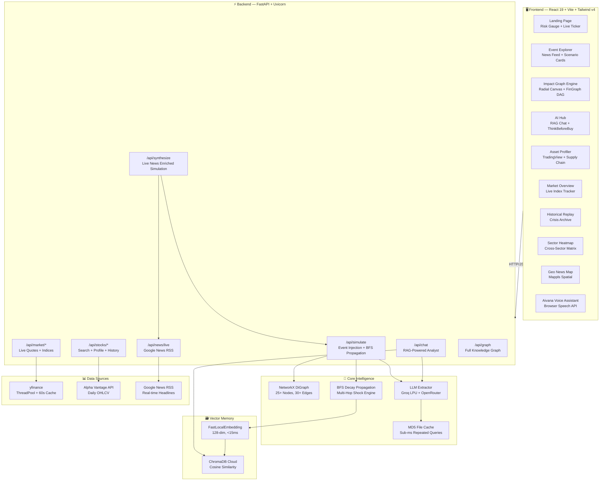
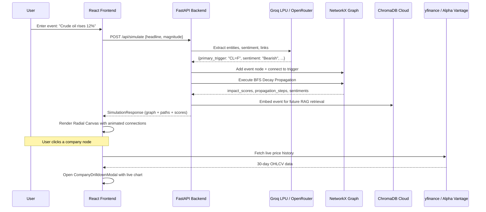

<p align="center">
  
</p>

<h1 align="center">Fin.D — Autonomous Financial Event Impact Graph Engine</h1>

<p align="center">
  <strong>Real-time causal intelligence that traces how financial shocks propagate through global markets</strong>
</p>

<p align="center">
  
  
  
  
  
  
  
  
</p>

---

## 🎯 What is Fin.D?

**Fin.D** is an autonomous financial event impact graph engine that answers a critical question traditional terminals cannot:

> *"If crude oil spikes 12% tomorrow, which Indian equities get hit, through what causal chain, and when does the margin compression show up in earnings?"*

Unlike static dashboards that show price tickers, Fin.D **traces multi-hop causal transmission** — from a breaking news catalyst through supply chains, commodity inputs, sector indices, and corporate margins — in real-time.

### Why It Matters
- **600+ institutional analysts** still manually map event-to-equity impact chains  
- **Average reaction lag** from event to portfolio adjustment: **4-6 hours**  
- **Fin.D reduces this to < 3 seconds** with autonomous graph propagation  

---

## 🏗️ System Architecture



---

## 🔬 Core Architecture Patterns

### 1. Multi-Hop BFS Decay Shock Propagation

The heart of Fin.D — when a financial catalyst is injected:

```
Event Node → BFS Queue → Edge Weight × Confidence → Transmitted Impact
                 ↓
    If impact ≥ threshold (4.0) → enqueue child nodes
    If impact < threshold → prune (attenuation halt)
```

**Decay Formula:** `transmitted_impact = parent_impact × edge_weight × (0.8 + 0.2 × confidence)`

**Sentiment Propagation:** Bearish shocks invert through cost-input edges (oil price up → airline margins down)

### 2. Dual LLM Provider Architecture

```
Primary: Groq LPU (qwen/qwen3.8-27b) → ~250-350ms latency
    ↓ (on failure)
Secondary: OpenRouter (GPT-4o / Claude 3.5 Sonnet)
    ↓ (on failure)
Tertiary: Deterministic Heuristic Fallback (zero-latency)
```

### 3. RAG Pipeline (Retrieval-Augmented Generation)

```
User Question → FastLocalEmbedding (128-dim) → ChromaDB Cosine Search
    ↓
Top-3 Similar Events Retrieved → Injected as LLM Context
    ↓
Grounded Answer (citing specific entities, timeframes, percentages)
```

---

## 📋 Complete Feature Inventory

| # | Feature | Component | Status |
|---|---------|-----------|--------|
| 1 | **Landing Page** — Animated risk gauge, live market ticker, scenario quick-launch | `LandingPage.tsx` | ✅ Working |
| 2 | **Event Explorer** — Browseable scenario cards with live news feed, "Synthesize Graph" action | `EventExplorerView.tsx` | ✅ Working |
| 3 | **Impact Graph (Radial Canvas)** — Interactive 360° causal topology with animated connection lines | `RadialTransmissionCanvas.tsx` | ✅ Working |
| 4 | **Impact Graph (FinGraph DAG)** — Multi-tier directed acyclic graph with ReactFlow | `FinGraphEngineView.tsx` | ✅ Working |
| 5 | **Canvas View Switcher** — Toggle between Radial and DAG views | `ScenarioHeader.tsx` | ✅ Working |
| 6 | **Impact Pathways Panel** — Right sidebar with multi-hop transmission details | `ImpactPathwaysPanel.tsx` | ✅ Working |
| 7 | **Company Drilldown Modal** — Deep-dive into any equity with live price chart | `CompanyDrilldownModal.tsx` | ✅ Working |
| 8 | **AI Hub & RAG Chat** — Conversational analyst powered by ChromaDB vector retrieval | `AIHubInsightsView.tsx` | ✅ Working |
| 9 | **ThinkBeforeBuy Card** — Pre-trade causal vulnerability scanner | `ThinkBeforeBuyCard.tsx` | ✅ Working |
| 10 | **Asset Profiler** — TradingView SuperChart + watchlist + supply chain graph | `AssetProfilerView.tsx` | ✅ Working |
| 11 | **Add Stock Modal** — Search 900+ NSE/BSE/NASDAQ equities and inject into graph | `AddStockModal.tsx` | ✅ Working |
| 12 | **Market Overview** — Live Nifty 50, Sensex, Bank Nifty, India VIX tracking | `MarketOverviewView.tsx` | ✅ Working |
| 13 | **Sector Heatmap** — Cross-sector performance matrix with simulate-shock action | `SectorHeatmapView.tsx` | ✅ Working |
| 14 | **Historical Crisis Replay** — 1973 OPEC, 2008 Lehman, 2020 COVID, 2023 SVB archives | `App.tsx` (inline) | ✅ Working |
| 15 | **Geo News Relation Map** — Mappls-powered spatial news visualization | `GlobalNewsRelationMap.tsx` | ✅ Working |
| 16 | **Event Regression Modal** — Econometric calibration (OLS, VAR, Bayesian) | `EventRegressionModal.tsx` | ✅ Working |
| 17 | **RBAC Login** — Role-based access (Quant Analyst, PM, Risk Officer, Trader) | `RbacLoginModal.tsx` | ✅ Working |
| 18 | **Auth Login Screen** — Full-fidelity authentication UI with demo bypass | `auth-section-1.tsx` | ✅ Working |
| 19 | **Aivana Voice Assistant** — Browser Speech Recognition AI companion | `AivanaVoiceAssistant.tsx` | ✅ Working |
| 20 | **Search Bar Analysis** — Top nav event analysis with smart keyword routing | `TopNav.tsx` | ✅ Working |
| 21 | **Live Market Ticker** — Streaming yfinance price bar | `LiveMarketTicker.tsx` | ✅ Working |
| 22 | **Google Translate** — Multi-language dropdown | `GoogleTranslateDropdown.tsx` | ✅ Working |
| 23 | **Collapsible Sidebar** — Pin/unpin/hide navigation rail | `Sidebar.tsx` | ✅ Working |
| 24 | **Toast Notifications** — Success/info feedback system | `App.tsx` | ✅ Working |
| 25 | **URL Hash Navigation** — Direct links to tabs, browser back/forward | `App.tsx` | ✅ Working |
| 26 | **Session Persistence** — localStorage for scenario, user, tab, watchlist | `App.tsx` | ✅ Working |
| 27 | **Engine Settings** — AI model config and system parameters | `EngineSettingsView.tsx` | ✅ Working |
| 28 | **Methodology & Docs** — Built-in documentation and methodology reference | `MethodologyDocsView.tsx` | ✅ Working |
| 29 | **Audit Reports** — System audit logs and reports | `AuditReportsView.tsx` | ✅ Working |

---

## 🛠️ Tech Stack

### Frontend
| Technology | Purpose |
|-----------|---------|
| **React 19** | UI framework with hooks and concurrent features |
| **Vite 8** | Lightning-fast HMR and build tooling |
| **TypeScript 6** | Full type safety across 318 lines of domain types |
| **Tailwind CSS v4** | Utility-first styling with CSS-first config |
| **Framer Motion** | Smooth sidebar and component animations |
| **GSAP 3** | Landing page scroll-driven animations |
| **Recharts** | Stock price sparkline charts |
| **@xyflow/react** | FinGraph multi-tier DAG canvas |
| **Lucide React** | Consistent icon system |
| **Mappls Web Maps** | Geospatial news relation mapping |

### Backend
| Technology | Purpose |
|-----------|---------|
| **FastAPI** | Async Python API with auto-generated Swagger docs |
| **Uvicorn** | ASGI production server |
| **NetworkX** | In-memory directed knowledge graph (25+ nodes, 30+ edges) |
| **Groq LPU** | Primary LLM inference (~250ms latency) |
| **OpenRouter** | Secondary LLM fallback (GPT-4o / Claude 3.5) |
| **ChromaDB Cloud** | Vector database for semantic event retrieval |
| **yfinance** | Real-time market data via ThreadPoolExecutor |
| **Alpha Vantage** | Daily OHLCV price history |
| **httpx** | Async HTTP client with connection pooling |
| **Pydantic** | Request/response validation models |

---

## 📡 API Specification

| Method | Endpoint | Description |
|--------|----------|-------------|
| `GET` | `/health` | Health check with node/edge counts and LLM status |
| `GET` | `/api/graph` | Full knowledge graph (nodes + edges) |
| `GET` | `/api/scenarios` | Preloaded historical shock scenarios |
| `POST` | `/api/simulate` | **Core engine** — event injection + BFS propagation |
| `POST` | `/api/synthesize` | Enhanced simulation with live news enrichment |
| `POST` | `/api/chat` | RAG-powered AI market analyst |
| `POST` | `/api/reset` | Reset graph to baseline state |
| `POST` | `/api/analyze` | Raw NLP event extraction |
| `POST` | `/api/stocks/scenario` | Generate radial scenario for any stock |
| `GET` | `/api/stock/{ticker}` | Price time-series and sparkline data |
| `GET` | `/api/stocks/search?q=` | Equity search (900+ NSE/BSE/NASDAQ) |
| `GET` | `/api/stocks/{ticker}/profile` | Company fundamentals + supply chain |
| `GET` | `/api/stocks/{ticker}/history` | Historical OHLCV price data |
| `GET` | `/api/market/live-quotes` | Real-time global benchmark prices |
| `GET` | `/api/market/indices` | Nifty 50, Sensex, Bank Nifty, India VIX |
| `GET` | `/api/market/quote/{ticker}` | Single ticker live quote |
| `GET` | `/api/market/ticker-map` | Batch ticker price dictionary |
| `GET` | `/api/news/live?q=` | Google News RSS live feed |
| `GET` | `/api/store/status` | Vector store size and RAG readiness |

---

## 🧩 Data Flow — End-to-End Simulation



---

## 📁 Repository Structure

```
Hackwave/
├── backend/
│   ├── main.py                    # FastAPI app — 18 endpoints
│   ├── config.py                  # Pydantic settings (Groq, OpenRouter, ChromaDB, Alpha Vantage)
│   ├── test_backend.py            # Backend integration tests
│   ├── .env                       # Environment variables (not committed)
│   ├── .env.example               # Template for required env vars
│   ├── cache/                     # MD5-hashed LLM response cache files
│   ├── data/
│   │   ├── market.py              # yfinance streaming + ThreadPool + 60s cache
│   │   ├── scenarios.py           # Preloaded historical shock scenarios
│   │   ├── seed_graph.py          # NetworkX baseline graph builder
│   │   └── stock_intelligence.py  # Equity search, profiles, news, scenario gen
│   ├── graph/
│   │   ├── models.py              # Pydantic models (GraphNode, GraphLink, etc.)
│   │   └── propagation.py         # BFS Decay multi-hop shock engine
│   └── llm/
│       ├── extractor.py           # LLM event extraction + httpx pooling
│       ├── prompts.py             # System prompts for extraction
│       └── vector_store.py        # ChromaDB Cloud + FastLocalEmbedding
├── frontend/
│   ├── package.json               # React 19, Vite 8, Tailwind v4, etc.
│   ├── vite.config.ts             # Vite build + proxy config
│   ├── tsconfig.json              # TypeScript 6 configuration
│   ├── public/
│   │   └── frames/hero/           # 240 scroll-animation frames
│   └── src/
│       ├── App.tsx                # Main router (1049 lines) — 12 nav tabs
│       ├── api.ts                 # API client + Alpha Vantage + synthetic fallback
│       ├── types.ts               # 318 lines of TypeScript domain types
│       ├── main.tsx               # React entry point
│       ├── assets/                # Images (orb, hero, login)
│       ├── components/
│       │   ├── LandingPage.tsx          # Animated landing with risk gauge
│       │   ├── EventExplorerView.tsx    # Scenario browser + live news
│       │   ├── RadialTransmissionCanvas.tsx  # 360° causal topology
│       │   ├── ImpactPathwaysPanel.tsx  # Multi-hop pathway inspector
│       │   ├── CompanyDrilldownModal.tsx # Equity deep-dive modal
│       │   ├── AIHubInsightsView.tsx    # RAG chat + AI insights
│       │   ├── ThinkBeforeBuyCard.tsx   # Pre-trade risk scanner
│       │   ├── AssetProfilerView.tsx    # TradingView + watchlist
│       │   ├── AddStockModal.tsx        # 900+ equity search & inject
│       │   ├── MarketOverviewView.tsx   # Live index dashboard
│       │   ├── SectorHeatmapView.tsx    # Cross-sector matrix
│       │   ├── GlobalNewsRelationMap.tsx # Mappls spatial map
│       │   ├── EventRegressionModal.tsx # Econometric calibration
│       │   ├── RbacLoginModal.tsx       # Role-based access
│       │   ├── AivanaVoiceAssistant.tsx # Voice AI companion
│       │   ├── Sidebar.tsx             # Navigation rail
│       │   ├── TopNav.tsx              # Search bar + user controls
│       │   ├── ScenarioHeader.tsx      # Scenario title + KPI cards
│       │   ├── ScenarioBar.tsx         # Scenario dropdown selector
│       │   ├── LiveMarketTicker.tsx    # Streaming price ticker
│       │   ├── SparklineChart.tsx      # Mini price charts
│       │   ├── TradingViewWidget.tsx   # TradingView embed
│       │   ├── GoogleTranslateDropdown.tsx  # i18n selector
│       │   ├── InteractiveGraph.tsx    # Force-directed 3D graph
│       │   ├── Header.tsx             # Legacy header component
│       │   ├── CascadeDrawer.tsx       # Cascade breakdown drawer
│       │   ├── SingleAppProfile.tsx    # Individual stock profile
│       │   ├── AppSelectorBar.tsx      # App-level selector
│       │   ├── LinkDetailPanel.tsx     # Link detail inspector
│       │   ├── NodeDetailPanel.tsx     # Node detail inspector
│       │   ├── fingraph/
│       │   │   ├── FinGraphEngineView.tsx  # ReactFlow DAG canvas
│       │   │   ├── GraphCanvas.tsx        # Graph rendering layer
│       │   │   ├── CustomNodes.tsx        # Custom ReactFlow nodes
│       │   │   ├── NodeInspector.tsx      # Node detail sidebar
│       │   │   ├── PersonaBar.tsx         # Analyst persona selector
│       │   │   ├── SimulationInput.tsx    # Simulation controls
│       │   │   ├── MiniPriceChart.tsx     # Inline price charts
│       │   │   ├── UncertaintyBanner.tsx  # Confidence disclaimer
│       │   │   └── DemoTour.tsx           # Interactive walkthrough
│       │   └── ui/
│       │       ├── auth-section-1.tsx     # Full auth screen
│       │       └── demo.tsx              # Demo component
│       ├── data/
│       │   ├── fingraphData.ts           # Baseline scenario definitions
│       │   ├── dynamicScenarioGenerator.ts  # Runtime scenario builder
│       │   └── mockEvents.ts             # Mock event data
│       ├── lib/
│       │   ├── marketData.ts             # Market data utilities
│       │   ├── scenarioConverter.ts       # Scenario format converter
│       │   └── utils.ts                  # Shared utilities
│       └── types/
│           └── fingraph.ts               # FinGraph-specific types
└── README.md                             # ← You are here
```

---

## 🚀 Local Development & Setup

### Prerequisites
- **Python 3.10+** (with pip)
- **Node.js 18+** (with npm)
- **Git**

### 1. Backend Setup
```bash
cd backend

# Create virtual environment
python -m venv .venv
# Windows: .venv\Scripts\activate
# macOS/Linux: source .venv/bin/activate

# Install dependencies
pip install -r requirements.txt

# Configure environment (copy and fill in API keys)
cp .env.example .env

# Start the API server
uvicorn main:app --host 0.0.0.0 --port 8000 --reload
```

### 2. Frontend Setup
```bash
cd frontend

# Install dependencies
npm install

# Start development server
npm run dev
```

### 3. Access Points
- **Frontend:** `http://localhost:3000`
- **Backend API:** `http://localhost:8000`
- **Swagger Docs:** `http://localhost:8000/docs`

---

## 🔐 Environment Variables

| Variable | Required | Description |
|----------|----------|-------------|
| `GROQ_API_KEY` | ✅ | Groq LPU inference key (primary LLM) |
| `GROQ_MODEL` | ❌ | Model name (default: `qwen/qwen3.8-27b`) |
| `OPENROUTER_API_KEY` | ❌ | OpenRouter fallback key |
| `ALPHA_VANTAGE_API_KEY` | ❌ | Alpha Vantage stock data key |
| `CHROMA_HOST` | ❌ | ChromaDB Cloud host |
| `CHROMA_API_KEY` | ❌ | ChromaDB API key |
| `CHROMA_TENANT` | ❌ | ChromaDB tenant ID |
| `CHROMA_DATABASE` | ❌ | ChromaDB database name (default: `find`) |

---

## 🏆 Key Differentiators

| Traditional Terminal | Fin.D |
|---------------------|-------|
| Shows price change after the fact | **Predicts causal transmission before it hits** |
| Manual sector rotation analysis | **Autonomous multi-hop BFS propagation** |
| Static analyst reports | **Real-time LLM-powered event extraction** |
| No memory of past shocks | **RAG-powered recall from vector database** |
| Single asset view | **Full supply chain graph visualization** |
| Hours to assess impact | **< 3 seconds end-to-end** |

---

## 👥 Team

Built with ❤️ for the hackathon by the **Fin.D** team.

## 📄 License

This project is licensed under the [MIT License](LICENSE).
