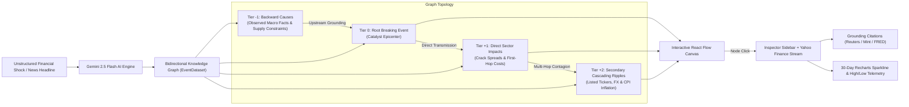

# FinGraph: Autonomous Financial Event Market Impact Graph

FinGraph is a Bloomberg-grade, bidirectional financial knowledge graph engine that traces macroeconomic shocks and geopolitical catalysts across global markets in real-time. Built with **React 19**, **Vite**, **TypeScript**, **Tailwind CSS**, **@xyflow/react (React Flow v12)**, **Recharts**, and **Google Gemini 2.5 Flash**.

---

## 🏛️ Architecture & Data Flow



---

## 🚀 Key Features for Evaluators

1. **Bidirectional Knowledge Graph Topology**:
   - **Tier -1 (Left)**: Backward causes & verified facts that catalyzed the event.
   - **Tier 0 (Center)**: Glowing root event epicenter with 100% confidence.
   - **Tiers +1 & +2 (Right)**: Forward sector pass-through and cascading ticker shocks.
2. **Interactive Node Isolation & Multi-Hop Contagion**:
   - Clicking any node isolates its upstream causal chain and downstream transmission paths while smoothly dimming unrelated graph elements (`opacity: 0.2`).
3. **Grounding & Truth Status Transparency**:
   - Strict categorization of `🟢 Observed Fact` vs. `🟡 Inferred Relationship`.
   - Confidence threshold filters: *Show All*, *Verified Facts Only*, *High Confidence (>75%)*.
   - Direct citations with timestamps and external links (Economic Times, Reuters, Mint, RBI, WSJ).
4. **Live Market Data & Yahoo Finance Sparklines**:
   - Integrated live price streaming API with real-time 30-day Area Chart sparklines, net changes, and 30-day high/low boundaries for assets (`NSE:BALRAMCHIN`, `NSE:ASIANPAINT`, `CL=F`, `NYSE:DAL`, etc.).
5. **Institutional Persona Customization**:
   - 🇮🇳 **Indian Retail / DII Perspective** (NSE/BSE, RBI policy, Monsoon, Crude import deficits).
   - 🇺🇸 **Global Macro Fund** (S&P 500, US Fed, Brent Crude, Dollar Index).
   - 🌾 **Agri & Commodity Trader** (Soft commodities, Biofuels, Fertilizer tariffs).
6. **Autonomous "What-If" AI Scenario Simulator**:
   - Powered by **Google Gemini 2.5 Flash**.
   - Accepts custom natural language headlines or 1-click test shock prompts.
   - Live multi-stage visual loader: `Extracting Entities → Tracing Precedents → Evaluating Transmission Channels → Generating Graph`.
7. **Guided Tour Walkthrough**:
   - Click **"Start Guided Tour"** in the top navigation bar for a 6-step modal orientation.

---

## 🛠️ Quickstart & Setup Guide

### 1. Prerequisites
- **Node.js** v18+ (tested on Node v20/v22)
- **npm** or **pnpm**

### 2. Installation
```bash
git clone <repo-url>
cd 4
npm install
```

### 3. Environment Variables
Create or verify your `.env.local` in the project root:

```env
GEMINI_API_KEY=YOUR_GEMINI_API_KEY_HERE
VITE_GEMINI_API_KEY=YOUR_GEMINI_API_KEY_HERE
```

> **Note**: An automated deterministic fallback is built into the engine so all graph interactions and benchmarks remain 100% functional even during network disconnection or API rate limits.

### 4. Run the Development Server
```bash
npm run dev
```
Open **`http://localhost:5173/`** in your browser.

### 5. Production Build
```bash
npm run build
```
Generates a minified, type-safe bundle in `dist/` with zero TypeScript errors.

---

## 📊 Benchmark Datasets Included

| Dataset ID | Market Focus | Scenario Title |
| :--- | :--- | :--- |
| `sugar-ethanol-policy-2024` | 🇮🇳 India | Government hikes Ethanol Blending Target to 20% & tightens Sugar Export Quotas |
| `hormuz-crude-shock-2024` | 🇺🇸 Global / US | Brent Crude Spikes 11% Following Strait of Hormuz Tanker Transit Disruptions |
| `fertilizer-grain-disruption-2024` | 🌾 Global Agri | Black Sea Grain Corridor Suspension & Potash Export Tariffs |

---

## 🔒 Compliance & Methodology Disclaimer
*Inferred transmission paths are probabilistic market projections based on macroeconomic elasticity models and historical precedent correlation; not financial advice.*
